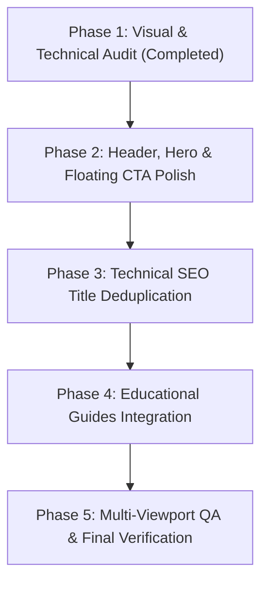

# Prioritized Improvement Plan: Golden Hair Wig Studio
**Project:** Golden Hair Wig Studio Portal  
**Primary Market:** Andhra Pradesh, India (Kadapa HQ, Proddatur, Madanapalle, Nandyal)  
**Host:** Cloudflare Pages (`https://golden-hair-wig-studio.pages.dev/`)  
**Date:** November 20, 2026  
**Status:** In Execution

---

## 1. Core Architecture & Strategic Goals

The website has successfully transitioned to an elegant, high-performance light theme (`#FFFFFF`, `#FAF8F4`, `#F4EFE7`, `#E8E2D8`, `#242424`, `#B58D4A`). The following targeted architectural improvements will elevate the site to the highest standard of international design, local Andhra Pradesh search dominance, and conversion optimization:

1. **Header & Navigation Polish:**
   - Resolve the horizontal gap between the brand logo and the desktop navigation items.
   - Ensure the centered navigation is balanced with equal whitespace on both sides.
   - Maintain instant accessibility for dropdown menus (`Hair Replacement`, `Our Services`, `Our Locations`).

2. **Hero Copy Refinement:**
   - Implement the exact recommended headline: *"Natural-Looking Hair Replacement. Confidence That Feels Like You."*
   - Pair with the localized supporting text covering Kadapa, Proddatur, Madanapalle, and Nandyal.

3. **Conversion Optimization & CTA Polish:**
   - Eliminate mobile button redundancy: hide the floating circular WhatsApp button on screens `< 1024px` where the sticky 3-button bottom bar already provides a dedicated WhatsApp action.
   - Elevate desktop footer vertical clearance so the floating WhatsApp widget never overlaps the `"Powered by MOMO IT TECHNOLOGIES"` badge.

4. **Technical SEO Title Fix:**
   - Update `SEOHead.tsx` to check whether the provided title string already contains the business name before appending `| Golden Hair Wig Studio`, eliminating duplicate title suffixing in search snippets.

5. **Educational Content Features:**
   - Provide dedicated, highly informative guides for high-intent searchers:
     * **Hair Patch vs Hair Transplant Guide:** Honest, balanced comparison of costs, invasiveness, maintenance, and suitability.
     * **Hair System Maintenance Guide:** Step-by-step expectations for scalp hygiene, adhesive re-bonding, and shampoo care.
     * **Hair Patch Cost Factors Guide:** Transparent explanation of factors influencing pricing (Swiss lace vs micro-skin, hair length, density, customization).

---

## 2. Phased Implementation Roadmap

### Phase 2: Navigation, Hero & Floating CTA Polish
- **Task 2.1 (Navbar Spacing):** In `src/components/Navbar.tsx`, add `mx-8` / `gap-8` and flex alignment to the centered `<nav>` container so that `HOME` has clean breathing room from the logo.
- **Task 2.2 (Hero Headline):** In `src/components/Hero.tsx`, set H1 to *"Natural-Looking Hair Replacement. Confidence That Feels Like You."*
- **Task 2.3 (Floating CTA Refinement):** In `src/components/FloatingWhatsApp.tsx`, add `hidden lg:flex` so mobile viewports rely on `FloatingMobileBar.tsx`, preventing duplicate floating buttons.
- **Task 2.4 (Footer Badge Polish):** In `src/components/Footer.tsx`, add `whitespace-nowrap flex-shrink-0` to the MOMO IT TECHNOLOGIES badge and ensure ample bottom padding.

### Phase 3: Technical SEO Title Deduplication
- **Task 3.1 (`SEOHead.tsx`):** Sanitize `title` input to ensure `| Golden Hair Wig Studio` is appended only if not already present.

### Phase 4: Educational Guides Integration
- **Task 4.1 (Educational Guides Component / Content):** Add comprehensive educational sections/guides covering:
  - *Hair Patch vs Hair Transplant*
  - *Hair System Maintenance*
  - *Hair Patch Cost Factors in Andhra Pradesh*
- **Task 4.2 (Navigation & Internal Links):** Ensure these guides are accessible through the navigation dropdowns and footer.

### Phase 5: Build, Test & QA Verification
- **Task 5.1:** Execute `npm run build` to verify 0 TypeScript/Vite errors.
- **Task 5.2:** Test using browser subagent across Desktop (1440px), Tablet (768px), and Mobile (375px).
- **Task 5.3:** Commit to Git and push to `origin main` for automatic Cloudflare Pages deployment.
